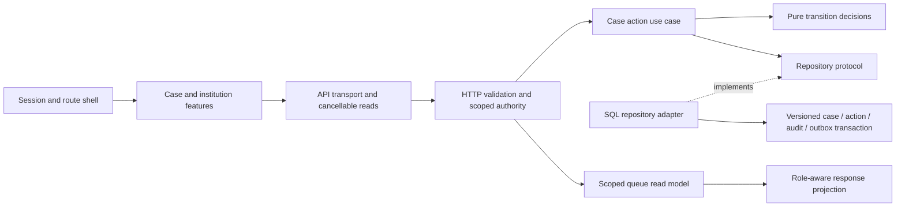

# Samanvay architecture and interface revision — 28 October 2026

The live application now uses a compact officer workspace with an ink navigation rail, a due-date queue, consistent controls and feature-organised case pages. This is a clearly labelled synthetic student prototype. The implementation and automated checks below are complete. **Rendered browser acceptance remains open.**

## Gaps inspected before editing

- The live application inherited the historical preview's global CSS and then overrode it. Live and preview fixtures were bundled together.
- Session handling, routing, account context and sign-in occupied one component; case list, intake, details and institutions shared a large screen file.
- The overview ranked only the 20 newest cases, potentially omitting an older urgent complaint.
- Case transition decisions and transaction orchestration were embedded in HTTP handlers.
- The existing revised interface had no current browser evidence because the tool denied the local origin.

The existing two databases were captured read-only before edits. There was no reset, reseed, complaint merge, migration or deletion of complaint data.

## Implemented

The work queue selects **all authorised active cases before limiting display to 12**. Open, overdue and assigned-to-me views have working server-side predicates and counts. Due dates order the queue; closed cases remain available through the complaint browser. Counts are scope-filtered, and response projection retains narrative restrictions.

The live UI now has a separate lazy-loaded entry, one token-based stylesheet and no dependency on preview fixtures. The historical `?preview=1` application retains its own CSS. Navigation, session lifecycle, sign-in, shell and route rendering are separate modules. Case list, intake, detail/history, institutions and the queue live in feature folders. Existing coordination, relationship review, transfers, notifications, reports and settings use the same live primitives and styling. Secondary actions remain disclosed. Synthetic status and absent official integration remain visible.

The resource hook cancels superseded reads and prevents a prior URL's result appearing in a new view. It invalidates on case and demo-clock events. Cancelled reads are distinguished from network failure. No application workflow state is stored in a mock client database.

Case action decisions now use immutable command/state snapshots and a pure domain function. The application use case depends on a repository protocol. The SQL adapter gathers evidence and information-request facts, then commits the version-checked update, audit event, outbox job, action and optional resolution together. HTTP routes still enforce scoped authority before constructing the adapter. Original submissions, ownership, institution identity, relationship decisions and coordination leads remain separate.

The role-aware response serializer moved out of the application factory. Its due-date projection was corrected: explicit daytime deadlines keep their IST calendar date; date-only intake deadlines retain the existing exclusive-midnight convention. Stored deadlines were not modified.

## Architecture boundary



This is a modular monolith and an incremental architecture replacement. Transfer, identity, matching, scheduling and reporting retain their existing service/registration modules and regression coverage. The SQL action adapter currently reuses the existing `change_case` transaction helper in `workflows.py`; those modules have not all been migrated to ports. SQLite, private files and the persistent worker remain in use. Microservices, PostgreSQL/RLS, production identity and external delivery were not implemented by this revision.

## Observed checks

| Check | Observed result | Evidence |
| --- | --- | --- |
| TypeScript + Vite production build | Pass; 50 modules, separate live CSS 23.08 kB and preview CSS 22.49 kB | `evidence/architecture-redesign-20261028/build.txt` |
| Frontend logic | 13 passed, 0 failed; includes navigation and cancellation | `frontend-tests.txt` |
| Full backend regression | 91 passed, 0 failed, one dependency deprecation warning; 138.36 seconds | `backend-tests.xml`, `backend-tests.txt` |
| Deadline follow-up | 24 passed, 0 failed, same warning; includes the new projection test plus vertical-slice and reporting checks | `deadline-followup.xml`, `deadline-followup.txt` |
| Static colour calculations | 16/16 selected text/background pairs meet 4.5:1 | `contrast.json` |
| Impeccable detector | One manual run returned `[]` | `design-detector.json` |
| Record preservation | Original 5 and isolated 8 cases; selected domain tables and all private evidence bytes unchanged | `before.json`, `after.json`, `preservation-result.json` |
| Runtime after API restart | API health OK, `/api/workspace` registered, unauthenticated call returns 401; listeners on 5174/8001 | `runtime.json` |
| Visual finish review | **recapture**: current desktop and mobile screenshots absent | `finish-review.md` |

The 24 follow-up checks overlap the full suite; these are not 115 distinct tests. Colour checks use source values, not browser-computed styles. The detector is a static tool, not accessibility or aesthetic certification.

## Commands actually run

From the project root unless a directory is stated:

```powershell
& C:/Users/loelb/.codex/skills/impeccable/scripts/impeccable.cmd context --target frontend/src/LiveApp.tsx
& C:/Users/loelb/.codex/skills/impeccable/scripts/impeccable.cmd concept-seed --scope direction --mode operate
.\backend\.venv\Scripts\python.exe scripts/check-redesign-preservation.py before architecture-redesign-20261028
.\backend\.venv\Scripts\python.exe scripts/refactor-architecture.py
.\backend\.venv\Scripts\python.exe scripts/refactor-frontend.py
.\backend\.venv\Scripts\python.exe scripts/split-feature-pages.py
.\backend\.venv\Scripts\python.exe scripts/check-redesign-contrast.py
.\backend\.venv\Scripts\python.exe scripts/check-redesign-preservation.py after architecture-redesign-20261028
.\backend\.venv\Scripts\python.exe scripts/finalize-architecture-evidence.py
& C:/Users/loelb/.codex/skills/impeccable/scripts/impeccable.cmd detect --json frontend/src/LiveApp.tsx frontend/src/app frontend/src/features frontend/src/shared frontend/src/design-system frontend/src/screens/WorkflowScreens.tsx frontend/src/screens/CoordinationScreens.tsx frontend/src/screens/OperationsScreens.tsx
.\scripts\run-service.ps1 -Service api -ContextId demo-5f5a439bfd2ea5ede367507b
```

The three refactor scripts are one-time source migrations, retained as an execution record; they are **not** application setup or database migrations. The initial concept attempt had no PRODUCT.md and produced no usable roll; PRODUCT.md was then written from the confirmed brief and the successful seed was `seed:969d8c49aff6fd08`. No visual comp approval is claimed.

In `frontend`:

```powershell
npm run build
npm test
npx --yes prettier@3 --write src/LiveApp.tsx src/App.tsx src/api.ts src/app src/features src/shared src/design-system src/ui.tsx src/screens/LiveScreens.tsx src/screens/WorkflowScreens.tsx src/screens/CoordinationScreens.tsx src/screens/MatchingScreens.tsx src/screens/OperationsScreens.tsx
```

In `backend`, with stdout/stderr retained in the evidence directory:

```powershell
$env:SAMANVAY_EVIDENCE_DIR=(Join-Path (Resolve-Path ..).Path 'docs/evidence/architecture-redesign-20261028')
$runTemp=Join-Path (Resolve-Path ../.local-data).Path ('architecture-tests-'+[guid]::NewGuid().ToString('N'))
.\.venv\Scripts\python.exe -m pytest --basetemp $runTemp --junitxml ../docs/evidence/architecture-redesign-20261028/backend-tests.xml -q
.\.venv\Scripts\python.exe -m pytest tests/test_architecture.py::test_deadline_projection_preserves_date_only_and_explicit_daytime_values tests/test_vertical_slice.py tests/test_reporting_scheduling.py --junitxml ../docs/evidence/architecture-redesign-20261028/deadline-followup.xml -q
```

Runtime checks used `Invoke-RestMethod` for API `/api/health` and `/openapi.json`, `Invoke-WebRequest -SkipHttpErrorCheck` for the unauthenticated API queue, and `Get-NetTCPConnection -State Listen -LocalPort 5174,8001`. The existing API was stopped through its known terminal session and restarted in the same marked demo context. No browser page was fetched through a workaround.

Read-only inspection used `rg`, `Get-Content`, `Get-ChildItem`, Git status and process inventory. A PowerShell brace-list search failed to parse and was corrected to explicit paths; attempted reads of `frontend/tsconfig.app.json` and `docs/PROJECT_STATE.md` found those files absent, then the actual `frontend/tsconfig.json` and root `PROJECT_STATE.md` were read. These inspection errors did not edit application state.

## Remaining limits and next phase

Automatic browser approval review again denied `http://127.0.0.1:5174` because a saved permission or managed policy blocks the origin, after the user explicitly said access was cleared. No alternate browser, port alias, CDP or screenshot workaround was attempted. Current desktop/mobile layout, keyboard flow, actual 200% zoom, supporting-screen rendering and UI write rehearsal are **not verified**. Historical screenshots cannot validate this revision. The independent design reviewer returned **recapture** for missing current captures.

Next: once the browser tool actually permits the origin, capture desktop and mobile, check supporting screens and focus order, verify native 200% zoom, rehearse mutations only in a separate synthetic context, and complete the design review. User authorization is already recorded; the remaining human/environment input is effective removal of the saved policy block. Independent clarity/relationship-label evaluation and official policy approval remain uncompleted human gates. No live AI/official/email service, real-world evaluation result or production readiness is claimed.

The code-and-regression portion of this revision is ready. **The redesigned UI acceptance gate is not ready to close.**

## Changed files

See `evidence/architecture-redesign-20261028/changed-files.json` for the source hash comparison and the explicit documentation, test and tooling list. The old `frontend/src/redesign.css` was removed; the historical preview stylesheet remains.
